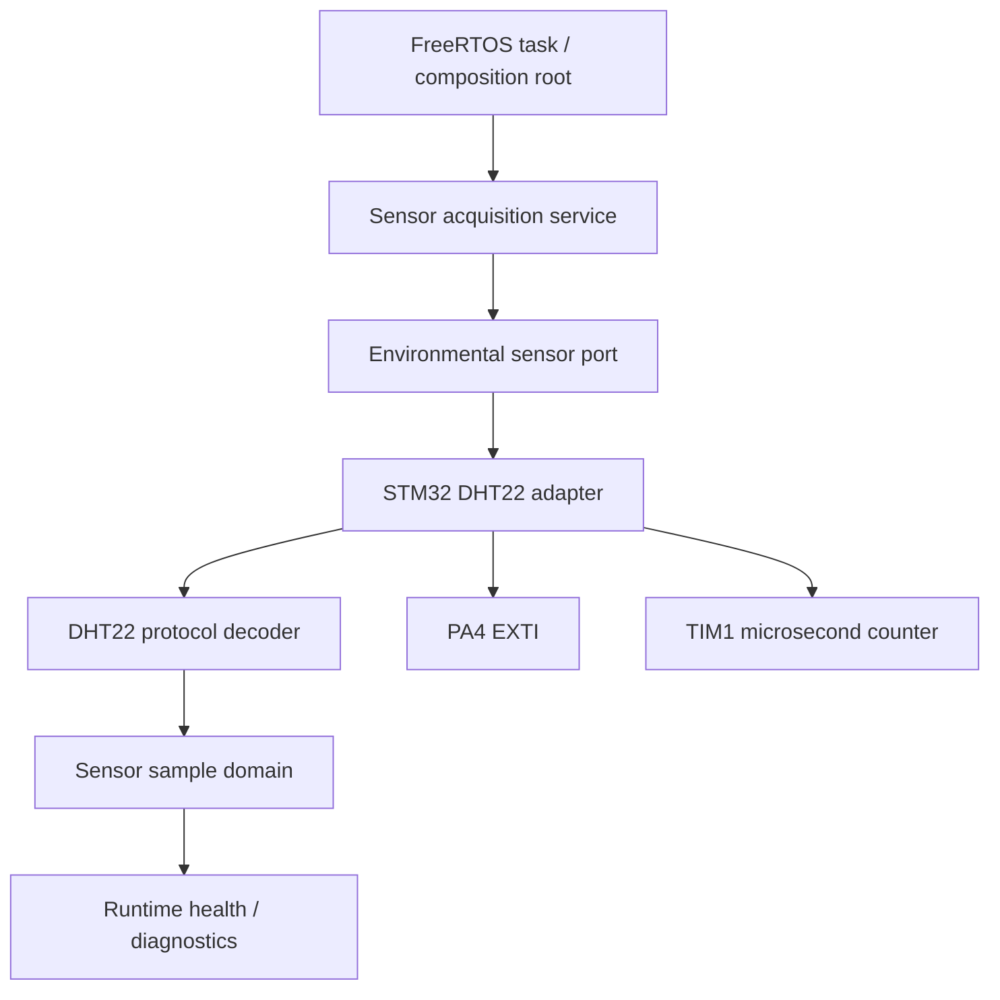

# STM32 SentinelRT

# SentinelRT

[](https://github.com/doko-rr/stm32-sentinelrt/actions)
[](LICENSE)
[](https://platformio.org/)
[](https://www.st.com/)

**SentinelRT** is a modular embedded monitoring firmware for the **STM32 NUCLEO-C031C6**. The project is designed as a practical reference for reliable sensor acquisition, runtime health supervision, fault handling, and testable real-time firmware architecture.

The codebase separates business rules from STM32 hardware details so that core behavior can be tested on a desktop while the same application runs on the microcontroller with FreeRTOS.

> **Project status:** Active development. The current focus is non-blocking environmental sensing with DHT22, runtime validation in Wokwi, and robust recovery from sensor failures.

## Why SentinelRT?

Embedded projects often begin with application logic directly coupled to GPIO, timers, interrupts, and RTOS calls. That approach works for small experiments, but becomes difficult to test and maintain as the firmware grows.

SentinelRT uses clear boundaries:

- **Domain layer** contains hardware-independent rules and data models.
- **Application layer** coordinates use cases and state machines.
- **Port layer** defines contracts required by the application.
- **Platform layer** implements those contracts using STM32 HAL.
- **Generated layer** contains STM32CubeMX-managed initialization code.

This structure keeps hardware code replaceable, reduces hidden dependencies, and allows most behavior to be validated with native tests.

## Key Features

- Clean architecture for embedded C firmware
- FreeRTOS-based runtime foundation
- Non-blocking sensor acquisition workflow
- DHT22 frame decoding with checksum validation
- Explicit sensor status, freshness, and last-good reading behavior
- System heartbeat and runtime health supervision
- STM32 HAL isolated behind application-facing ports
- STM32CubeMX-managed GPIO, EXTI, clock, and timer configuration
- Native unit tests with Unity and PlatformIO
- Firmware regression builds for NUCLEO-C031C6
- GitHub Actions continuous integration
- Wokwi-ready simulation workflow
- Git checkpoint workflow for safe rollback before critical changes

## Target Hardware

| Component | Selection |
|---|---|
| Development board | STM32 NUCLEO-C031C6 |
| MCU | STM32C031C6 |
| Core | Arm Cortex-M0+ |
| System clock | 48 MHz |
| RTOS | FreeRTOS through CMSIS-RTOS2 |
| Environmental sensor | DHT22 |
| Sensor data pin | PA4 with rising/falling EXTI |
| Timing source | TIM1 at 1 MHz, approximately 1 microsecond per tick |
| Development environment | PlatformIO and STM32CubeMX |
| Simulation target | Wokwi |

## Architecture



### Repository Layers

```text
firmware/
├── domain/          Hardware-independent data and protocol rules
├── application/     Use cases and non-blocking state machines
├── ports/           Interfaces required by the application
└── platform/        STM32-specific adapter implementations

Inc/                 STM32CubeMX-generated and user headers
Src/                 STM32CubeMX-generated startup and integration code
test/                Native Unity test suites
scripts/             PlatformIO build and validation helpers
.github/workflows/   Continuous integration pipelines
```

## Sensor Acquisition Flow

The acquisition application is designed to avoid blocking the RTOS task:

1. The application requests a measurement.
2. The STM32 adapter starts the DHT22 transaction.
3. PA4 edge interrupts capture timing information.
4. TIM1 provides microsecond timestamps.
5. The task polls the adapter without busy-waiting.
6. Pulse data is decoded outside the interrupt context.
7. A valid frame updates the latest trusted reading.
8. Timeout, checksum, or hardware failures preserve the last-good reading and update diagnostics.

The interrupt handler is intentionally small. Checksum validation, floating-point conversion, logging, and application decisions do not run inside the ISR.

## Getting Started

### Prerequisites

Install:

- Git
- Python 3
- Visual Studio Code with the PlatformIO extension, or PlatformIO Core
- STM32CubeMX for editing `stm32-sentinelrt.ioc`
- A supported ARM GCC toolchain, installed automatically by PlatformIO when available

### Clone

```bash
git clone https://github.com/doko-rr/stm32-sentinelrt.git
cd stm32-sentinelrt
```

### Build the STM32 Firmware

```bash
pio run -e nucleo_c031c6
```

### Run Native Tests

```bash
pio test -e native
```

### Clean the Build

```bash
pio run -e nucleo_c031c6 -t clean
```

## STM32CubeMX Workflow

Open:

```text
stm32-sentinelrt.ioc
```

When regenerating code:

1. Create a Git checkpoint first.
2. Keep **Keep User Code when re-generating** enabled.
3. Generate peripheral initialization as separate `.c/.h` files when applicable.
4. Review every generated diff before committing.
5. Re-run native tests and the firmware build.
6. Do not place domain or application business logic in generated files.

## Testing Strategy

SentinelRT uses two complementary validation paths.

### Native Tests

Native tests exercise hardware-independent behavior on the host machine, including:

- sensor reading validation
- status and freshness behavior
- acquisition state transitions
- timeout handling
- last-good value preservation
- DHT22 pulse classification
- frame packing
- checksum validation
- positive and negative temperature decoding
- diagnostic status naming

### Firmware Regression Build

The STM32 build validates:

- generated CubeMX source
- HAL and FreeRTOS integration
- include paths and linker inputs
- target-specific compilation
- RAM and flash usage
- warning-free compilation

## Development Rules

- Keep domain and application layers independent from STM32 HAL.
- Use ports to cross architecture boundaries.
- Avoid heap allocation in runtime firmware paths.
- Avoid long busy-waits and `HAL_Delay()` in application workflows.
- Keep interrupt handlers short and deterministic.
- Preserve output values when an operation fails.
- Add tests before integrating a new adapter into FreeRTOS.
- Create a Git checkpoint before every critical generated-code change.
- Commit only after native tests, firmware build, whitespace checks, and scope checks pass.

## Overview

STM32 SentinelRT is a clean-architecture firmware project for the STM32C031C6 that acquires DHT22 temperature and humidity data without blocking the FreeRTOS scheduler. The implementation separates domain logic, application services, ports, STM32 platform bindings, and runtime composition so that protocol and acquisition behavior remain host-testable.

## Validation Status

Current validated baseline:

- ✅ 11/11 DHT22 adapter tests pass
- ✅ 58/58 native tests pass
- ✅ STM32 firmware builds with 0 warnings and 0 errors
- ✅ Wokwi normal runtime reports `VALID`, 24.0 C, and 55.0 percent
- ✅ A disconnected sensor reports `TIMEOUT` without publishing false measurements
- ✅ Valid readings recover after the sensor connection is restored
- ✅ Final Stage 3D-6 audit passes 42/42 checks
- ✅ GitHub Actions succeeds for the validated feature commit

## Build Firmware

From the repository root:

```powershell
pio run -e nucleo_c031c6 -t clean
pio run -e nucleo_c031c6
```

The build generates `firmware.bin` and `firmware.elf` under `.pio/build/nucleo_c031c6/`.

## Run the Wokwi Simulation

Build the firmware, open the repository in VS Code with the Wokwi extension, and start the simulator using `diagram.json` and `wokwi.toml`. The default simulation connects DHT22 SDA to PA4, configures 24 C and 55 percent, and routes USART2 telemetry through PA2/PA3.

## Contributing

Contributions are welcome. For a predictable review process:

1. Create a focused branch.
2. Keep changes within one architectural concern.
3. Add or update tests.
4. Run native tests and the target firmware build.
5. Confirm `git diff --check` passes.
6. Explain architecture decisions and hardware assumptions in the pull request.

## Safety and Scope

SentinelRT is an educational and portfolio firmware project. It is not certified for safety-critical, medical, automotive, industrial protection, or other regulated production use. Hardware timing and recovery behavior must be independently validated before deployment to a real system.

## Roadmap Progress

### Completed and validated

- ✅ **Stage 1: Project foundation**
- ✅ **Stage 2: Clean architecture foundation**
- ✅ **Stage 3D-1: STM32 and Wokwi baseline**
- ✅ **Stage 3D-2: DHT22 protocol engine**
- ✅ **Stage 3D-3: PA4 and TIM1 timing foundation**
- ✅ **Stage 3D-4A: Non-blocking DHT22 adapter engine**
- ✅ **Stage 3D-4B: STM32 DHT22 HAL binding**
- ✅ **Stage 3D-5: FreeRTOS composition**
- ✅ **Stage 3D-6: End-to-end runtime validation**
  - Normal runtime: `VALID`, 24.0 C, 55.0 percent
  - Disconnected sensor: `TIMEOUT` without false data
  - Recovery: `VALID` after reconnecting the sensor
  - 11/11 adapter tests, 58/58 native tests, and 42/42 final audit checks

### Next milestone

- ⬜ **Stage 4: Production hardening**
  - Long-duration soak testing
  - Sensor health counters and fault statistics
  - Watchdog integration
  - Stack and memory budget policies
  - Additional fault injection and physical-board validation

## License

This project is licensed under the [MIT License](LICENSE).

Copyright (c) 2026 doko-rr.
